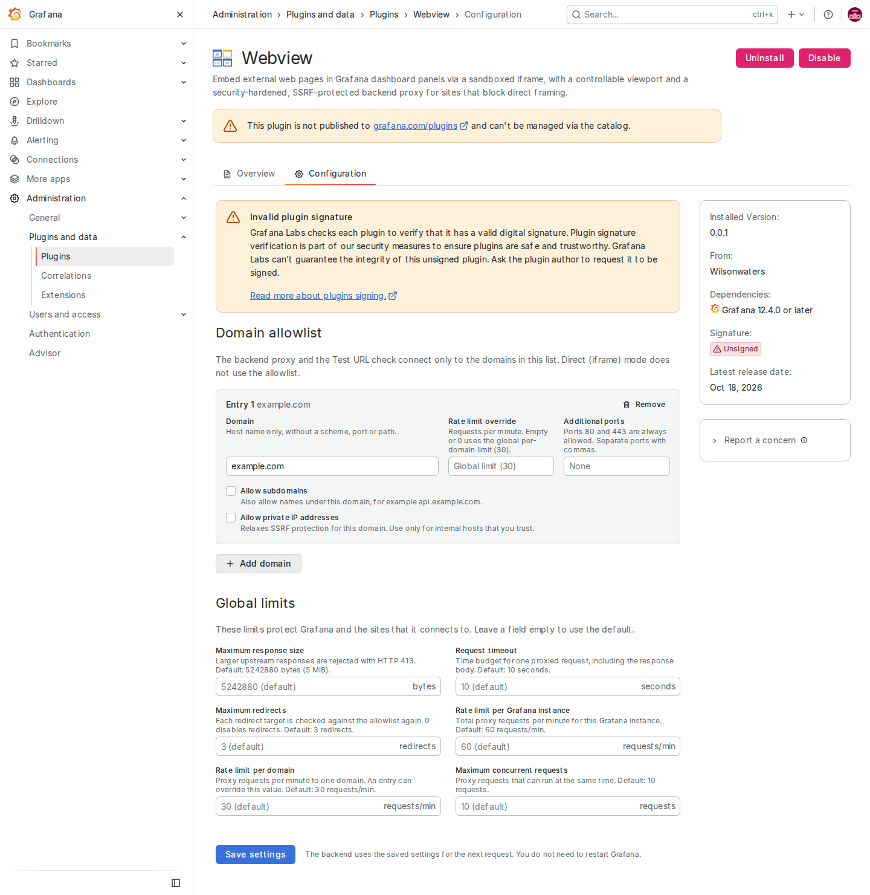
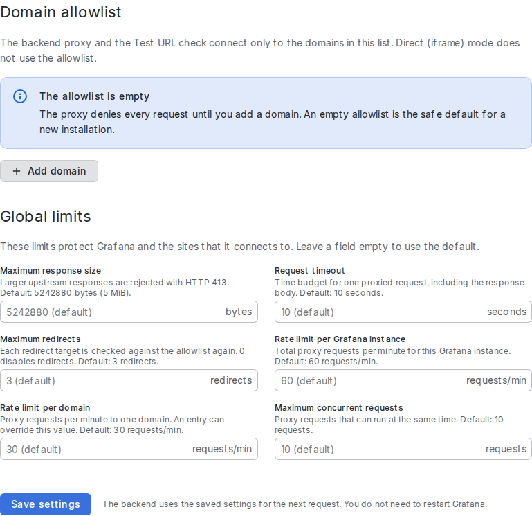

# Administration Guide

Operational guide for Grafana administrators and operators running the **Web View**
app plugin (`wilsonwaters-webview-app`).

The plugin ships a backend proxy that fetches external pages on behalf of
dashboard viewers, strips framing headers, and rewrites HTML so the page renders
inside a panel, in an isolated sandboxed frame. Because the backend can reach whatever the Grafana host can reach,
operating it safely is an administrative responsibility. This document is the
operational **how**: setup, configuration, tuning, monitoring, and incident
response.

For the security **why** — the threat model, the layered controls (SF1–SF5), and
the residual-risk analysis — see
[`docs/architecture.md`](./architecture.md). This guide deliberately does **not**
duplicate the threat model; it references it. See also the top-level
[`SECURITY.md`](../SECURITY.md) for the security posture summary and vulnerability
reporting, [`docs/installation.md`](./installation.md) for install methods,
and [`docs/signing.md`](./signing.md) for signing and secrets.

---

## 1. First-time setup checklist

1. **Install the plugin** and restart Grafana. Because this is a backend app
   plugin, Grafana loads it at startup. See
   [`docs/installation.md`](./installation.md) for install methods and
   [`docs/signing.md`](./signing.md) for signed-build requirements.
2. **Enable the app.** Go to **Administration → Plugins and data → Plugins →
   Webview** and enable it.
3. **Understand the fail-closed default: nothing works until you allowlist
   domains.** On a fresh install the allowlist (`jsonData.allowedDomains`) is
   **empty**, and an empty allowlist **denies every proxy request** (HTTP 403).
   This is intentional containment, not a bug — the plugin proxies nothing until
   you explicitly add the domains you trust.
4. **Add your allowed domains** on the app's **Configuration** page (see
   [§2](#2-allowlist-management)). Only add sites that every user of the
   organisation may see (see [Who can use the proxy](#who-can-use-the-proxy)).
5. **Verify.** As an Editor or Admin, use the panel's **Test URL** control
   against an allowlisted host and confirm you get a verdict (Direct or Proxied)
   rather than a 403 allowlist denial.
6. **Review the tuning defaults** ([§4](#4-tuning)) and the monitoring setup
   ([§6](#6-metrics--suggested-alerts)) before putting the plugin in front of
   users.

---

## 2. Allowlist management

The allowlist is the plugin's primary SSRF / open-proxy containment. It is stored
in the plugin instance's **non-secret `jsonData`** under `allowedDomains`. These
are operational settings, not secrets, so they intentionally live in `jsonData`
(not `secureJsonData`).

### Where configuration lives

Manage the allowlist and the limits on the app's **Configuration** page:
**Administration → Plugins and data → Plugins → Webview → Configuration**. Only
organisation Admins see this page.



- **Domain allowlist** — **Add domain** adds an entry. Each entry has a
  **Domain**, a **Rate limit override**, **Additional ports**, and the
  **Allow subdomains** and **Allow private IP addresses** check boxes (see
  [Per-domain options](#per-domain-options)). **Remove** deletes an entry.
- **Global limits** — the six limits in [§4](#4-tuning). Leave a field empty to
  use the default.
- **Save settings** checks every field first. If a field is invalid (for
  example a domain with a scheme or path, a port out of range, or `0` for a
  limit that must be at least 1), nothing is saved and the field shows the
  error.
- **Changes apply without a restart.** Saving stores the settings in the
  plugin's `jsonData`. Grafana then gives the backend a new plugin instance that
  reads them (`LoadSettings` in `pkg/plugin/config.go`, called from `NewApp`),
  so the next proxy request uses the new allowlist and limits.
- Saving keeps any other `jsonData` keys and removes the unused `apiUrl` key
  left over from the plugin scaffold.



You can also manage the settings through the Grafana plugin-settings API:
`POST /api/plugins/wilsonwaters-webview-app/settings` with a body that contains
`enabled`, `pinned` and the **complete** `jsonData` object. The API replaces
`jsonData` as a whole, so send every setting you want to keep.

> **Provisioning is for development and CI only.** The repository's
> `provisioning/plugins/apps.yaml` adds `example.com` to the allowlist for the
> local development container and the end-to-end tests. Do not copy it to a
> production Grafana: a production install starts with an empty allowlist
> (deny all), and an administrator adds domains on the Configuration page.
> Grafana applies a provisioning file at every start, and it replaces the
> settings saved on the Configuration page.

### Who can use the proxy

Grafana requires a signed-in user for every call to the plugin backend. Beyond
that, the plugin applies these rules:

| What | Who |
| --- | --- |
| Load a proxy-mode panel (`/proxy`) | Every user of the organisation, including Viewers. If Grafana's anonymous access is on, anonymous viewers too. |
| **Test URL** in the panel editor (`/check-frameable`) | Users whose organisation role is **Editor** or **Admin**. |
| Configuration page | Organisation **Admins**. |

The proxy has no role check because dashboard viewers must be able to load
proxy-mode panels. **The allowlist and the rate limits are the access control
for the proxy.** Any signed-in user can fetch any allowlisted URL through it,
and can find out whether a given host is on the allowlist, so:

- Allowlist only sites that every user of the organisation may see.
- Do not treat the allowlist as confidential.
- If you turn on Grafana's anonymous access, anyone who can reach Grafana can
  use the proxy for the allowlisted sites, within the rate limits.

Each request is audit-logged with the user's Grafana login (see
[§5](#5-audit-logging)).

### Allowlist shape

The Configuration page writes these keys for you. For the settings API, each
allowlist entry is a domain plus a per-domain `options` object:

```yaml
jsonData:
  allowedDomains:
    - domain: status.example.com        # bare hostname: no scheme, port, or path
      options:
        allowSubdomains: false          # default false (exact-match only)
        allowPrivateIP: false           # default false — see §3
        rateLimitPerMin: 0              # 0 = use the global per-domain default
        allowedPorts: []                # empty = standard 80/443 only
```

The equivalent JSON (`jsonData`) uses the same keys:
`allowedDomains[].domain`, and under `allowedDomains[].options`:
`allowSubdomains`, `allowPrivateIP`, `rateLimitPerMin`, `allowedPorts`.

> **Key casing matters.** The private-IP opt-in key is spelled **`allowPrivateIP`**
> (capital `IP`). The others are `allowSubdomains`, `rateLimitPerMin`,
> `allowedPorts`.

### Per-domain options

The Configuration page label for each key is shown in brackets.

- **`domain`** (**Domain**) — the bare hostname (e.g. `status.example.com`). No
  scheme, port, path or wildcard. The Configuration page rejects such values; an
  entry sent through the API whose domain cannot be canonicalised is
  **skipped**, never matched loosely.
- **`allowSubdomains`** (**Allow subdomains**, default `false`) — when `false`,
  only the exact hostname matches. When `true`, subdomains also match, but only
  on a real label boundary (`api.example.com` matches `example.com`; the suffix
  trick `example.com.evil.com` does **not**). Prefer exact matches; broad apex +
  subdomain entries widen the SSRF surface.
- **`allowedPorts`** (**Additional ports**, default empty) — only ports **80 and
  443** are permitted by default. List any additional TCP ports this domain may
  be reached on (e.g. `[8443]`, or `8443` on the page). Keep this minimal.
- **`rateLimitPerMin`** (**Rate limit override**, default `0`) — overrides the
  global per-domain rate limit for this domain only. `0` (or an empty field)
  means "use the global default" (`rateLimitPerDomainPerMin`). See
  [§4](#4-tuning).
- **`allowPrivateIP`** (**Allow private IP addresses**, default `false`) — a
  deliberate, scoped SSRF opt-in. The page shows a warning while it is selected.
  Covered in detail in [§3](#3-the-allowprivateip-opt-in).

---

## 3. The `allowPrivateIP` opt-in

`allowPrivateIP` is a **per-domain, admin opt-in** (default `false`) that
deliberately **relaxes the SSRF IP blocklist** so that domain may resolve to a
private address. Treat enabling it as consciously accepting a narrow SSRF surface
for that one domain.

**What it relaxes:** **RFC 1918 private IPv4 only** — `10.0.0.0/8`,
`172.16.0.0/12`, `192.168.0.0/16`. Nothing else.

**What it never relaxes (stays blocked even when opted in):**

- **Loopback** (`127.0.0.0/8`, `::1`)
- **Link-local**, **including the `169.254.169.254` cloud-metadata address**
  (`169.254.0.0/16`, `fe80::/10`)
- **CGNAT** (`100.64.0.0/10`), **IPv6 ULA** (`fc00::/7`), unspecified, multicast,
  reserved/documentation ranges, and the fail-closed unparseable sentinel.
- An RFC 1918 address wrapped in a 6to4 (`2002::/16`) or NAT64
  (`64:ff9b::/96`) IPv6 address.

Because loopback, link-local, and the metadata IP are never relaxed, this opt-in
cannot be used to reach cloud-metadata endpoints.

**Operational properties:**

- It is applied **narrowly** — only for the specific domain that matched, and
  **recomputed on every request and every redirect hop**.
- It is **audit-logged**: each admitted private IP produces a distinct `Warn`
  line, `proxy private-ip permitted by opt-in` (see [§5](#5-audit-logging)).
- It is **metered**: each admitted private IP increments
  `webview_proxy_private_ip_permitted_total{ipClass}` (see
  [§6](#6-metrics--suggested-alerts)).

**Guidance:** use it **sparingly**, only for trusted internal targets such as an
internal status board, and only after you have explicitly accepted the risk. Keep
the domain exact (avoid combining it with `allowSubdomains`). Monitor the permit
metric and the `Warn` audit line. For the full residual-risk analysis, see
[`docs/architecture.md`](./architecture.md#residual-risk-the-allowprivateip-opt-in-scoped-ssrf-surface).

---

## 4. Tuning

Set these six limits in the **Global limits** section of the Configuration page
(leave a field empty for the default), or as `jsonData` keys through the API.
The page rejects values that the backend would replace (for example `0` for a
limit that must be at least 1). The backend itself is also **fail-closed**: a missing, zero, or negative value is replaced with the safe
default below (`applyDefaults` in `pkg/plugin/config.go`), so you cannot
accidentally disable a limit by zeroing it — the default is reapplied.

| Configuration page label | `jsonData` key | Default | What it controls |
| --- | --- | --- | --- |
| Rate limit per Grafana instance | `rateLimitPerInstancePerMin` | `60` | Max proxy requests per minute for one Grafana **organisation** (token bucket). Each organisation has its own budget. Over-limit → **429**. |
| Rate limit per domain | `rateLimitPerDomainPerMin` | `30` | Max proxy requests per minute to any single target domain. Over-limit → **429**. Overridable per domain via `options.rateLimitPerMin`. |
| Maximum concurrent requests | `maxConcurrentRequests` | `10` | Max in-flight proxy requests at once. Exceeded → **429**. |
| Maximum response size | `maxResponseBytes` | `5242880` (5 MiB) | Max upstream response body size. Oversize → **413**. Also bounds the **gzip-decoded** size (decompression-bomb guard) and the size of the rewritten HTML. |
| Request timeout | `requestTimeoutSec` | `10` | Per-request timeout in seconds covering the **whole** round-trip and body copy. Expiry → **504**. |
| Maximum redirects | `maxRedirects` | `3` | Max HTTP redirects followed for one request; each hop is re-validated against the allowlist and IP blocklist. **`0` disables redirect following** entirely. Exceeded → **502**. |

The rate limits and the concurrency cap apply to `/proxy` and `/check-frameable`
together.

Notes:

- `maxRedirects` is special: an explicit `0` is honoured as "no redirects". Only an
  **absent** field falls back to the default of `3`; a negative value is clamped
  to `3`.
- For `maxResponseBytes`, `requestTimeoutSec`, the two rate limits, and
  `maxConcurrentRequests`, any value `<= 0` is treated as invalid and reset to the
  default — so the way to make a limit *looser* is to raise it, never to zero it.

**Sizing the rate limits:** one proxy-mode panel load is one proxy request,
because the page's images, scripts and stylesheets load directly from the site.
Each open dashboard repeats that request for every proxy-mode panel at every
auto-refresh interval. For example, 10 viewers with a dashboard of 3 proxy
panels that refresh every 60 seconds make 30 requests per minute.

**Tuning guidance:** start from the defaults. Raise `maxResponseBytes` only if you
proxy legitimately large pages; raise `requestTimeoutSec` for slow upstreams, but
keep it low enough that stalled fetches do not pile up against
`maxConcurrentRequests`. Raise the rate limits for high-traffic dashboards, and
prefer a per-domain `rateLimitPerMin` override to a global bump when only one busy
domain needs headroom.

**Memory:** rewriting large HTML pages is memory-intensive; see the sizing note.
<!-- TODO(orchestrator): add the sizing note (memory per rewrite and the rewrite concurrency cap) here. -->


---

## 5. Audit logging

The proxy emits **exactly one structured audit entry per request** to `/proxy`
and `/check-frameable` (an `Info` line, message `proxy request`) through the
plugin backend's standard logger, including for denied requests, with these
fields:

| Field | Meaning |
| --- | --- |
| `endpoint` | `proxy` (panel loads) or `check-frameable` (**Test URL**) |
| `url` | The validated, normalised target (or a placeholder such as `<missing>` / `<invalid>` on an early denial) |
| `user` | The requesting Grafana login, or `anonymous` when no user is identifiable |
| `status` | Final HTTP status returned to the client |
| `bytes` | Response body bytes written |
| `duration` | Handler duration |
| `allowPrivateIP` | Whether the matched domain had the opt-in set for this request |

In addition, **each private IP admitted by the `allowPrivateIP` opt-in** produces a
distinct, high-signal `Warn` line — message `proxy private-ip permitted by opt-in`
— carrying `endpoint`, `url`, `user`, `permittedIP`, and `ipClass`. This line
fires only when an opted-in domain actually resolved to and reached a private
address, so it should be rare and worth investigating whenever it appears.

**Where to find it:** these entries go to the plugin backend's logs, which surface
in Grafana's server log output (and are captured by whatever log shipping your
deployment uses). Filter on the `proxy request` / `proxy private-ip permitted by
opt-in` messages, or on the `endpoint` / `status` / `user` fields.

---

## 6. Metrics & suggested alerts

The backend registers Prometheus collectors (`pkg/plugin/metrics.go`) on the
default registry; they are served on the plugin backend's standard metrics
endpoint via the Grafana plugin SDK's diagnostics adapter — scrape it the same way
as any plugin backend's metrics.

| Metric | Type | Labels | Meaning |
| --- | --- | --- | --- |
| `webview_proxy_requests_total` | counter | `status` | All `/proxy` and `/check-frameable` requests, by final HTTP status. |
| `webview_proxy_denials_total` | counter | `reason` | Denied requests, by denial reason (see below). |
| `webview_proxy_requests_in_flight` | gauge | — | Requests currently in flight. |
| `webview_proxy_request_duration_seconds` | histogram | — | Request handling duration. |
| `webview_proxy_private_ip_permitted_total` | counter | `ipClass` | Private IPs admitted by an `allowPrivateIP` opt-in, by relaxed IP class (today only `private`). |

**`denials_total{reason}` label values** (and the status each maps to):

| `reason` | Status | Cause |
| --- | --- | --- |
| `allowlist` | 403 | Host not allowlisted (incl. a redirect into a non-allowlisted host) |
| `ip-blocklist` | 403 | Resolved/connect IP is blocked |
| `metadata` | 403 | Cloud-metadata host |
| `rate-limit` | 429 | Per-instance or per-domain rate tier exceeded |
| `concurrency` | 429 | Concurrency cap exhausted |
| `size-limit` | 413 | Response exceeds `maxResponseBytes` |
| `scheme` | 400 | Bad scheme/port/userinfo/host |
| `bad-request` | 400 | Missing `url` / unbuildable target |
| `method` | 405 | Non-GET method |
| `timeout` | 504 | Per-request budget expired |
| `upstream` | 502 | Upstream resolve/transport/gateway failure, or an unsupported `Content-Encoding` |
| `redirect-loop` | 502 | Redirect depth cap exceeded |
| `role` | 403 | **Test URL** (`/check-frameable`) called by a user whose org role is below Editor |

### Suggested alerts (PromQL)

These are starting points — tune thresholds to your traffic.

- **SSRF / blocked-destination attempts spiking** (denials for internal targets):

  ```promql
  sum(rate(webview_proxy_denials_total{reason=~"ip-blocklist|metadata|allowlist"}[5m])) > 1
  ```

- **Any private-IP permit** (the opt-in actually reached a private address — expect
  this to be near-zero unless you intentionally run internal targets):

  ```promql
  sum(increase(webview_proxy_private_ip_permitted_total[15m])) > 0
  ```

- **Elevated upstream / gateway errors**:

  ```promql
  sum(rate(webview_proxy_requests_total{status=~"5.."}[5m]))
    / sum(rate(webview_proxy_requests_total[5m])) > 0.1
  ```

- **Sustained rate-limit / concurrency pressure** (may mean limits are too tight,
  or abuse):

  ```promql
  sum(rate(webview_proxy_denials_total{reason=~"rate-limit|concurrency"}[5m])) > 1
  ```

---

## 7. Incident response

If you suspect abuse or an SSRF attempt:

1. **Check the signals first.** Look at `webview_proxy_denials_total{reason="ip-blocklist"|"metadata"|"allowlist"}`
   and the `proxy private-ip permitted by opt-in` `Warn` lines / the
   `webview_proxy_private_ip_permitted_total` metric. The audit log's `user`,
   `url`, and `status` fields tell you who requested what and whether it was
   denied.
2. **Tighten the allowlist.** Remove any domain you did not intend to allow,
   remove `allowSubdomains` where exact matches suffice, and drop extra
   `allowedPorts`.
3. **Disable risky opt-ins.** Clear **Allow private IP addresses**
   (`allowPrivateIP: false`) on any domain that does not strictly require it.
4. **Throttle.** Lower `rateLimitPerInstancePerMin` / `rateLimitPerDomainPerMin`
   and `maxConcurrentRequests` to contain volume while you investigate.
5. **Contain hard if needed.** Disable the app (Administration → Plugins and
   data → Plugins → Webview) to stop all proxying, or remove every allowlist
   entry to fall back to deny-all.
6. **Apply and verify** — **Save settings** on the Configuration page. The next
   request uses the new settings; no restart is needed. If a provisioning file
   manages the settings, change it too, or the next Grafana start restores the
   old values. Then re-verify with a Test URL.

Remember the hardcoded IP blocklist (loopback, link-local, the metadata IP, CGNAT,
ULA, reserved) **cannot be disabled or extended at runtime** and is not reachable
even when `allowPrivateIP` is set. If you believe you have found a bypass, follow
the reporting process in [`SECURITY.md`](../SECURITY.md).

---

## 8. IP blocklist (high-level)

The backend enforces a **hardcoded, non-configurable** IP blocklist on every
resolved address (`pkg/security/ipblocklist.go`). It cannot be disabled or extended
at runtime. It blocks:

- RFC 1918 private IPv4 (`10/8`, `172.16/12`, `192.168/16`)
- Loopback (`127/8`, `::1`)
- Link-local, including the `169.254.169.254` cloud-metadata address
  (`169.254/16`, `fe80::/10`)
- CGNAT (`100.64/10`), IPv6 ULA (`fc00::/7`), unspecified, multicast, and
  reserved/documentation ranges, including the NAT64 local-use prefix
  `64:ff9b:1::/48`

6to4 (`2002::/16`) and NAT64 well-known-prefix (`64:ff9b::/96`) addresses are
classified by the IPv4 address they carry, so an internal IPv4 target stays
blocked in either form. A NAT64 address that carries a public IPv4 address is
allowed, so the proxy works on IPv6-only hosts that use DNS64. NAT64 prefixes
that an operator chooses (RFC 6052 network-specific prefixes) cannot be
detected; if your network uses one, block it with your network egress policy.

Unparseable or unclassifiable addresses **fail closed** (treated as blocked). The
blocklist runs as part of a resolve-then-dial flow that also re-validates the
concrete connect-time IP, defeating DNS rebinding, and blocks known cloud-metadata
hostnames by name before resolution. The only authorised relaxation is the narrow,
per-domain `allowPrivateIP` opt-in ([§3](#3-the-allowprivateip-opt-in)), which
covers RFC 1918 IPv4 only. For the full mechanism (SF1 and SF4), see
[`docs/architecture.md`](./architecture.md#4-layered-security-controls-sf1sf5).

---

## 9. Interaction with Grafana's `[security.egress]` controls

The plugin's allowlist and IP blocklist are **defense-in-depth alongside**, **not a
replacement for**, Grafana's own network-level egress controls (`[security.egress]`
in Grafana's configuration). Both layers apply to the requests the backend makes:

- Grafana's `[security.egress]` allowlist (where configured) restricts which hosts
  the Grafana process and its plugins may reach at the network layer.
- The plugin's `allowedDomains` is a second, plugin-level allowlist on top of that.

A target must pass **both** to be fetched. The plugin does not bypass, loosen, or
substitute for `[security.egress]`; if you operate an egress allowlist, make sure
the domains you allowlist in this plugin are also permitted by your
`[security.egress]` policy, otherwise the fetch fails at the network layer even
though the plugin would permit it. See the non-goals in
[`SECURITY.md`](../SECURITY.md) for the project's stated posture.

---

## 10. Upgrade & rollback

- **Plugin upgrades / downgrades:** install the target version and restart
  Grafana. Settings in `jsonData` carry across versions (same keys).
- **Upgrading from a 0.0.1 build:** the scaffold **API URL** and **API Key** fields are
  gone. The first save on the new Configuration page removes the unused
  `apiUrl` key; the plugin never read either value.
- **`plugin.json` changes require a Grafana server restart.** Any change to the
  plugin manifest only takes effect after restarting Grafana.
- **Signed builds:** installs must satisfy Grafana's plugin-signing requirements.
  Private-signed builds are valid only for the Grafana root URLs they were signed
  for, so a rollback to a build signed for different root URLs may fail to load.
  See [`docs/signing.md`](./signing.md) for signing, root-URL scoping, and secret
  handling.
- **After any upgrade/rollback,** re-verify the allowlist took effect with a Test
  URL, and confirm metrics are still being scraped.

---

## 11. Known operational caveats

- **A provisioning file overrides the Configuration page.** If a file under
  `provisioning/plugins/` sets this plugin's `jsonData`, Grafana applies it at
  every start and replaces what was saved on the Configuration page. Use one
  method per instance. Production installs should not provision the allowlist
  (see [§2](#2-allowlist-management)).

- **Grafana's Content Security Policy blocks proxied scripts.** With
  `[security] content_security_policy = true`, proxy-mode panels show markup and
  images only; scripts and external stylesheets are blocked. Direct mode is not
  affected.

- **Viewers' browsers must reach the proxied sites.** Proxy mode sends only the
  HTML page through Grafana; images, scripts and stylesheets load from the site
  in each viewer's browser. Allowlisting a site that only the Grafana server can
  reach gives a page without styles or images.

- **The allowlist is not confidential**, and every signed-in user (including
  anonymous viewers, if anonymous access is on) can use the proxy for
  allowlisted sites. See [Who can use the proxy](#who-can-use-the-proxy).

- **Test URL uses the basic org role.** A user whose basic role is Viewer but who
  can edit dashboards through a custom RBAC role cannot run **Test URL**. They
  can still choose the load mode by hand.

- **The repository's Docker Compose setup is for local development only.** It
  signs every visitor in as an anonymous Admin, runs Grafana in development
  mode and loads the unsigned plugin. Never expose it to an untrusted network or
  copy its environment variables to a production Grafana. Install the signed
  release archive in production (see [`installation.md`](./installation.md)).

For the other limits of proxy mode (isolated origin, single-page apps, bot
protection) see
[`docs/architecture.md`](./architecture.md#7-proxy-mode-rendering-fr5).
