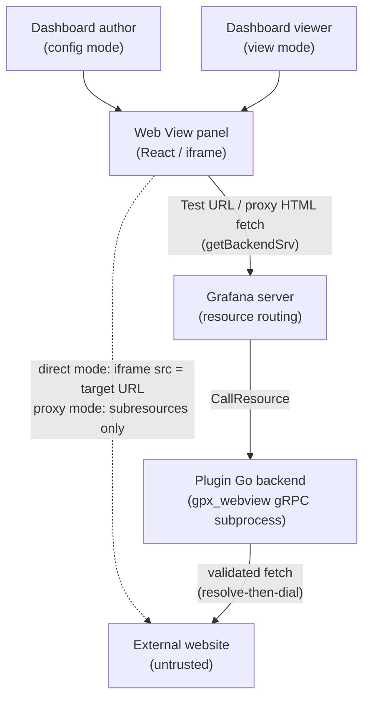
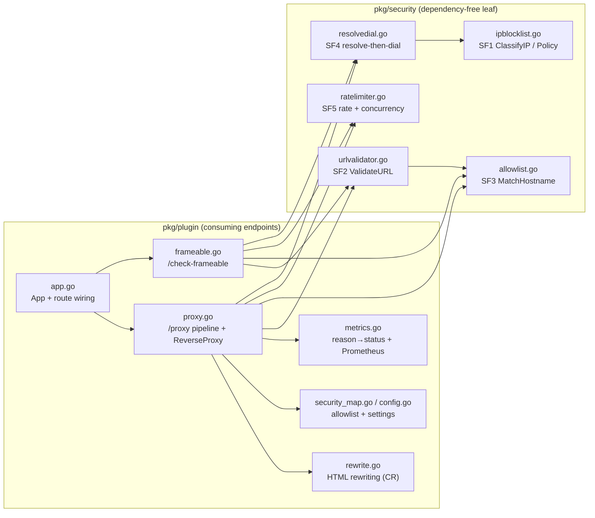
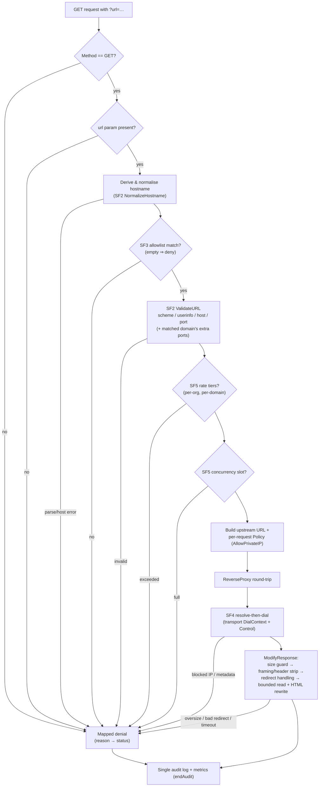

# Architecture & Threat Model

This document is the authoritative security reference for the Grafana Web View
app plugin (`wilsonwaters-webview-app`). It describes **what** the system does,
**how** the request pipeline is layered, and **why** each control exists —
grounded in the actual backend implementation under `pkg/security/` and
`pkg/plugin/`.

For **how to configure and tune** the controls described here (allowlist
entries, limits, the private-IP opt-in, reading audit logs and metrics), see
[`docs/administration.md`](./administration.md). For the public-facing security
policy and how to report a vulnerability, see [`SECURITY.md`](../SECURITY.md).

> Scope note: every security claim below is tied to the file and function that
> implements it. If you change the code, update the mapping. Diagrams use
> Mermaid defaults with no hardcoded colors so they render in both light and
> dark themes.

---

## 1. System overview

The plugin is a Grafana **app plugin** with a Go backend that ships a nested
**Web View panel**. The panel embeds an external web page inside a dashboard
panel and lets an author pan/zoom to a fixed viewport (e.g. one city on a
weather radar). There are two hard-separated modes:

- **Configuration mode** (panel editor) — author enters a URL, runs a
  frameability check, picks a load mode, positions the viewport.
- **View mode** (dashboard viewer) — static render at the saved viewport; no
  detection, no interactive pan/zoom.

A page is loaded one of two ways, decided at config time:

- **Direct iframe** — for sites that permit framing; the iframe `src` is the
  target URL and the backend is never involved.
- **Backend proxy** — for sites that block framing (`X-Frame-Options` / CSP
  `frame-ancestors`); the Go backend fetches the HTML page server-side, strips
  framing-control headers and rewrites every URL in the page to an absolute
  upstream URL. The panel reads that HTML with `getBackendSrv().fetch` and
  renders it in `<iframe srcdoc sandbox="allow-scripts">`. The frame has an
  opaque origin, so the page's scripts cannot reach Grafana. Subresources
  (images, scripts, stylesheets) load directly from the upstream site in the
  viewer's browser. See [§7](#7-proxy-mode-rendering-fr5).

**The backend proxy is the security-critical component.** It is a stateless
fetcher: it forwards no cookies, no `Authorization`, no `X-Grafana-*` identity
to the upstream, maintains no sessions, and executes no proxied JavaScript
server-side. Every security control is on by default and fails closed.

In **direct** mode the viewer's browser talks to the upstream directly (dotted
line) and the backend is bypassed entirely. In **proxy** mode the HTML document
flows through the backend security pipeline; the subresources that the page
references load from the upstream in the viewer's browser (dotted line).

---

## 2. Component & data-flow view

The backend is a single Go gRPC subprocess (`gpx_webview`) that Grafana routes
resource calls to. Routes are registered on an `http.ServeMux` behind the SDK's
`httpadapter` (`pkg/plugin/app.go`, `pkg/plugin/resources.go`).

**`pkg/security` is a deliberately dependency-free leaf**: it imports no project
package, takes every input as a primitive or injected value, and fails closed on
anything it cannot prove safe. The consuming endpoints in `pkg/plugin` wire the
leaf blocks together, read settings, and own audit logging and metrics.

---

## 3. Request pipeline order

`/proxy` and `/check-frameable` run the **identical pre-fetch pipeline**
(`proxyHandler.ServeHTTP` in `pkg/plugin/proxy.go`; `checkFrameable` in
`pkg/plugin/frameable.go`). The order is load-bearing: the allowlist is matched
**before** the final port check so a per-domain non-standard port can be
honoured, and the IP blocklist runs at connect time inside the transport so it
cannot be skipped. `/check-frameable` adds one gate in front of the pipeline:
the caller's org role must be Editor or Admin (see
[Access control](#access-control)).

Pre-upstream denials are written by `writeDenial`; post-upstream
(transport/ReverseProxy) denials by `proxyErrorHandler`. Both derive the client
status **and** the metric reason from the single `reasonStatus` table in
`metrics.go`, so the status and the recorded reason can never drift. Exactly one
audit log line and one metrics emission happen per request, from a single Go
`defer` (`endAudit`).

---

## 4. Layered security controls (SF1–SF5)

All five "security foundation" blocks live in `pkg/security` and are consumed by
the pipeline above. Each is summarised here with its file and the guarantee it
provides.

### SF1 — Hardcoded IP blocklist

**File:** `pkg/security/ipblocklist.go` (`ClassifyIP`, `ClassifyIPPolicy`,
`Policy{AllowPrivate}`).

A fixed, non-configurable set of CIDR ranges that a resolved IP is classified
against. There are **no exported setters and no config inputs** — the ranges are
the single source of truth and cannot be disabled or extended at runtime. Blocked
ranges, with their stable reason tokens:

| Reason token  | Ranges |
| ------------- | ------ |
| `unspecified` | `0.0.0.0/32`, `::/128` |
| `private`     | `10.0.0.0/8`, `172.16.0.0/12`, `192.168.0.0/16` (RFC 1918) |
| `loopback`    | `127.0.0.0/8`, `::1/128` |
| `link-local`  | `169.254.0.0/16` (incl. the `169.254.169.254` cloud-metadata IP), `fe80::/10` |
| `cgnat`       | `100.64.0.0/10` (RFC 6598) |
| `ula`         | `fc00::/7` (IPv6 unique-local) |
| `multicast`   | `224.0.0.0/4`, `ff00::/8` |
| `reserved`    | `0.0.0.0/8`, `192.0.0.0/24`, `192.0.2.0/24`, `198.18.0.0/15`, `198.51.100.0/24`, `203.0.113.0/24`, `240.0.0.0/4`, `64:ff9b:1::/48` (NAT64 local-use), `::/8`, `2001:db8::/32`, `100::/64`, `2001::/23` |

Key properties:

- **IPv4-mapped IPv6 unwrap** — `::ffff:a.b.c.d` is collapsed to its IPv4 form
  before classification, so a mapped address cannot bypass the IPv4 ranges.
- **6to4 and NAT64 unwrap** — a 6to4 address (`2002::/16`) or a NAT64
  well-known-prefix address (`64:ff9b::/96`) is classified by the IPv4 address
  it embeds (`embeddedIPv4`). An internal IPv4 target stays blocked in either
  form; a well-known-prefix address that wraps a public IPv4 address is allowed,
  so the proxy works on IPv6-only hosts with DNS64. The NAT64 local-use prefix
  `64:ff9b:1::/48` is always blocked. Operator-specific NAT64 prefixes (RFC 6052)
  cannot be detected and are classified as ordinary IPv6 addresses.
- **Fail-closed sentinel** — a `nil` or unparseable IP is treated as blocked with
  reason `reserved`. Callers must never dial an address they cannot classify.
- **Opt-in relaxation boundary** — `ClassifyIPPolicy` with `Policy{AllowPrivate:
  true}` relaxes **only** `ReasonPrivate` (RFC 1918 IPv4). The single auditable
  boundary is `isRelaxablePrivate`, which returns true **only** for
  `ReasonPrivate`. Loopback, link-local (incl. metadata), CGNAT, ULA,
  unspecified, multicast, reserved, and the fail-closed sentinel are **never**
  relaxable, and neither is an RFC 1918 address wrapped in a 6to4 or NAT64
  address. See §6 for the threat-model treatment of this opt-in.

### SF2 — Scheme / port / URL validation

**File:** `pkg/security/urlvalidator.go` (`ValidateURL`, `NormalizeHostname`).

- **Scheme allowlist:** only `http` and `https`. `file://`, `gopher://`,
  `dict://`, etc. are rejected (`ReasonScheme`).
- **Userinfo rejected:** embedded credentials (`user:pass@host`) are refused
  outright (`ReasonUserinfo`) — a common SSRF/credential-leak vector.
- **Port restriction:** only 80 and 443 by default; a matched domain may permit
  extra ports via its `AllowedPorts` option. Port 0 and out-of-range ports are
  rejected (`ReasonPort`).
- **Hostname normalisation:** lowercase, trailing-dot stripped, IDN/Unicode
  folded to ASCII punycode (IDNA2008 lookup profile). IP-literal hosts are
  canonicalised but not run through IDNA. The **same** `NormalizeHostname` is used
  by SF3, so request hosts and configured domains fold to identical ASCII forms —
  homograph/case/trailing-dot tricks cannot slip past or spoof an allowlist entry.

### SF3 — Allowlist (deny-all by default)

**File:** `pkg/security/allowlist.go` (`MatchHostname`); config mapping in
`pkg/plugin/security_map.go` + `pkg/plugin/config.go`.

- **Empty-by-default = deny-all.** A `nil`/empty allowlist denies every hostname
  (`ResultNoMatch`). A fresh install proxies nothing until an admin adds domains.
  This is the plugin's primary SSRF/open-proxy containment.
- **Exact match** always applies; **subdomain match** only when the entry opts in
  via `AllowSubdomains`, and only on a true label boundary (`.example.com`), so
  `notexample.com` and the suffix trick `example.com.evil.com` do not match.
- An entry whose configured domain cannot be canonicalised is **skipped**, never
  matched loosely, and does not poison the rest of the list.
- On match, the per-domain `EntryOptions` (subdomain flag, `AllowPrivateIP`,
  `RateLimitPerMin`, `AllowedPorts`) are returned so downstream controls apply the
  right per-domain policy. `AllowPrivateIP` enters the dial path **only** here,
  recomputed on every request (and every redirect hop).

### SF4 — Resolve-then-dial (DNS-rebinding defense)

**File:** `pkg/security/resolvedial.go` (`ResolveAndValidate`,
`ResolveAndValidatePolicy`, `NewControl`/`NewControlPolicy`, `Dialer.DialContext`,
`IsMetadataHostname`).

This block closes the gap between validating a hostname and connecting to it —
where DNS rebinding lives. The flow:

1. **Metadata-name block (unconditional, pre-resolution):** a hostname matching a
   known cloud-metadata name (`metadata.google.internal`, `metadata.goog`) is
   rejected by name before any DNS lookup (`ReasonMetadataHost`). This is
   defence-in-depth on top of SF1's block of `169.254.169.254`. The name set is
   GCP-specific by design: AWS/Azure/Alibaba expose metadata only via the bare
   `169.254.169.254` IP (no DNS name), which SF1 already blocks at the IP layer.
2. **Resolve all records** through an injectable resolver.
3. **Validate every resolved IP** through SF1. **Multi-record fail-closed:** if
   *any* single returned address is blocked, the whole request is rejected — a
   DNS answer mixing one public and one internal address never results in a
   "pick the good one" dial.
4. **Dial the validated IP literal directly**, not the hostname, so a later DNS
   answer cannot redirect the connection. The hostname is never handed to the
   dialer, so `http.Transport` preserves the `Host` header and TLS SNI from the
   request URL.
5. **Connect-time rebind guard:** a `net.Dialer.Control` hook
   (`NewControlPolicy` → `validateConnectAddrPolicy`) re-classifies the concrete
   IP the OS is about to connect to, **before** the socket connects. This is the
   authoritative gate that defeats a rebind landing between resolution and
   connect — it does not trust the earlier resolve result, it validates the actual
   wire address.

Obfuscated IP-literal encodings (decimal `2130706433`, octal `0177.0.0.1`, hex
`0x7f.0.0.1`) are not parsed by Go's resolver: passed as a host they go to DNS,
fail to resolve, and are rejected (`ReasonResolveFailed`, fail closed) — they
never reach `Control`.

### SF5 — Rate limiting, concurrency, size & timeout

**File:** `pkg/security/ratelimiter.go` (`RateLimiter`); size/timeout enforcement
in `pkg/plugin/proxy.go` (`enforceResponseSize`, `limitedBody`,
`decodeGzipBounded`, the per-request timeout context).

- **Two token-bucket tiers** per request: the "instance" tier and the
  per-target-domain tier (with optional per-domain overrides). The instance tier
  is keyed on the Grafana organisation (the plugin context's namespace,
  `instanceIDFromContext`), so each organisation has its own budget. A
  non-positive limit **disables** that tier (fail-closed: every request of that
  tier denied). Limiter reasons: `rate-instance`, `rate-domain` → HTTP 429.
- **Concurrency cap** on in-flight requests (`Acquire`/release); a non-positive
  cap rejects every acquire. Reason `concurrency` → 429.
- **Response-size limit** (`MaxResponseBytes`, default 5 MiB): a declared
  `Content-Length` over the limit short-circuits to a clean 413. Otherwise
  `prepareHTMLBody` reads the whole body (bounded by `limitedBody`) **before**
  the proxy sends a status, so an oversize chunked or under-reported body is
  also a 413 and is never delivered as a truncated 200. **Gzip-bomb guard:** the
  *decoded* size of a gzip body is bounded by the same limit, for HTML and for
  every other content type, and the rewritten HTML must fit the limit too. A
  `Content-Encoding` other than gzip is refused with 502, because its decoded
  size cannot be bounded.
- **Per-request timeout** (`RequestTimeoutSec`, default 10s): one budget wraps the
  entire round-trip **and** the body copy, so a slow/stalled upstream body trips
  it too (not just connection setup). Expiry → 504.

### Cross-cutting controls

These are not numbered SF blocks but are part of the same defense-in-depth.

**Outbound header hygiene** (`stripRequestHeaders`, `proxy.go`): every outgoing
request has credentials/identity/origin headers removed — `Cookie`,
`Authorization`, `Proxy-Authorization`, the `X-Forwarded-*`/`Forwarded`/`Via`
family, edge/CDN client-IP headers, and **every `X-Grafana-*` header by prefix
sweep**. A conservative non-browser `User-Agent` (`grafana-webview-proxy`) and
`Accept` are set, and `Accept-Encoding` is pinned to `gzip` so net/http does not
transparently (and unboundedly) auto-decompress before the size guard runs.

**Inbound response-header strip** (`stripFramingHeaders`, `proxy.go`):
`Set-Cookie` (all values), `Strict-Transport-Security`, `Public-Key-Pins`
(+ report-only), and `Clear-Site-Data` are removed so the upstream cannot set
cookies on, or pin origin-level security policy onto, the Grafana origin the
response is served from. `Refresh` is removed, because a browser follows it like
a redirect without the per-hop re-validation that `Location` gets. Every
`Access-Control-*` header is removed: the panel calls the proxy from the same
origin, so the proxy sends no CORS headers and passes none through.
`X-Frame-Options` is deleted and the CSP `frame-ancestors` directive is stripped
(other CSP directives preserved).

**Content rewriting** (`pkg/plugin/rewrite.go`): top-level HTML is parsed with
`goquery` (never regex) and prepared for the panel's `srcdoc` frame:

- a `<base href>` with the absolute upstream base becomes the first child of
  `<head>`, so URLs built at runtime and CSS `url()` resolve against the
  upstream;
- every URL attribute (`src`, `href`, `srcset`, `poster`, `action`, …) becomes
  an absolute upstream URL, so nothing routes back through Grafana;
- `<meta name="referrer" content="no-referrer">` is injected (and the page's own
  referrer policies removed), so the upstream never receives the Grafana
  dashboard URL in a `Referer` header;
- a small compatibility script gives the page in-memory `document.cookie`,
  `localStorage` and `sessionStorage`, only where the real ones throw inside the
  opaque-origin frame. It grants no access to Grafana;
- `<meta http-equiv>` CSP and `refresh` metas are removed, and **frame-buster
  scripts** (inline scripts that compare `top`/`self` and navigate
  `top.location`) are neutralised.

The connection pool also matters: `DisableKeepAlives` is set on the transport so
a connection validated under one domain's policy is never reused for another
request — see §6.

**Panel URL validation** (`src/panels/webview/url.ts`, `validateWebViewUrl`):
the panel accepts only an absolute `http:` or `https:` URL with a host and no
credentials. `javascript:`, `data:`, `blob:`, relative URLs and URLs with
control characters render an error instead of an iframe, in view mode and in
the editor preview.

**Per-mode iframe sandbox** (`src/panels/webview/sandbox.ts`, `iframeSandbox`,
used by `WebViewFrame.tsx` for the panel and the editor preview):

| Frame | `sandbox` value | Why |
| ----- | --------------- | --- |
| Proxy mode (`srcdoc`) | `allow-scripts` | A `srcdoc` document would otherwise have the Grafana origin. Without `allow-same-origin` its scripts run in an opaque origin and cannot read the Grafana session or call the Grafana API. |
| Direct mode, cross-origin URL | `allow-scripts allow-same-origin` | The page keeps its own origin (and its own cookies). That origin is not Grafana's. |
| Direct mode, URL on the Grafana origin | `allow-scripts` | Prevents Grafana-origin access through a same-origin URL. |

`allow-popups`, `allow-forms`, `allow-modals` and `allow-top-navigation*` are
never set. Both iframes use `referrerPolicy="no-referrer"` and
`pointer-events: none`, and the panel never listens for `message` events from
the frame. Unit tests in `sandbox.test.ts` and the panel tests enforce this.

**Author hide-selectors** (`hide_selectors.go`): `/proxy` refuses (400) more
than 20 selectors, a selector over 256 bytes, and `cascadia`'s expensive
features (`:has()`, `:contains()`, `:matches()`, `#=`, `:not()` with
combinators); combinators are resolved in one linear pass and the matching
work per page is capped (413 beyond it). Selectors are
applied by **finding matched elements and setting a fixed
`display:none!important` style attribute** — the selector text never enters the
rendered markup, so markup injection is impossible by construction (AC 31).

### Access control

Grafana authenticates every call to
`/api/plugins/wilsonwaters-webview-app/resources/*` and checks basic plugin
access. It does **not** apply the `role` of an `includes[]` entry in
`plugin.json` to these calls; that role only controls who sees the Configuration
page in the navigation. Any further check is the plugin's job. The plugin reads
the caller's basic org role from the plugin context
(`backend.PluginConfigFromContext(ctx).User`).

| Route | Who can call it | Why |
| ----- | --------------- | --- |
| `GET /proxy` | Any signed-in org user (Viewer and up; anonymous viewers when Grafana's anonymous access is on) | Dashboard viewers must be able to render proxy-mode panels. |
| `GET /check-frameable` | Org role **Editor** or **Admin** (`hasEditorRole`) | Only the panel editor's **Test URL** button uses it. |
| `GET /health` | Any signed-in org user | Liveness only; reads no settings and contacts no upstream. |

- `/check-frameable` checks the role **first**, before the method, URL,
  allowlist and rate-limit gates. A missing user, an empty role, `Viewer`,
  `None` or an unknown role gets **403** with a JSON body
  (`{"error":"Forbidden","reason":"role",…}`). The denial is audited and counted
  (`webview_proxy_denials_total{reason="role"}`).
- The check uses the **basic** org role. A user whose basic role is Viewer but
  who can edit dashboards through a custom RBAC role cannot use **Test URL**.
- `/proxy` has no role gate. Its controls are the admin-managed allowlist (empty
  by default), the IP blocklist with resolve-then-dial, the scheme and port
  checks, the rate limits, the concurrency cap, the response-size limit and the
  audit log (the `user` field records the Grafana login). Any signed-in user can
  fetch any allowlisted URL through it, so admins must allowlist only hosts that
  every user of the organisation may read.
- **The allowlist is not confidential.** `/proxy` answers a non-allowlisted host
  with a distinct `403 target host is not allowlisted`, so any signed-in user can
  learn whether a given host is on the list.

---

## 5. Assurance controls

- **Non-skippable security test suite (AC 17–31, 36).** The backend security
  behaviours are covered by dedicated Go tests (`pkg/plugin/proxy_security_*`,
  `proxy_denial_matrix_test.go`, `proxy_audit_test.go`, `pkg/security/*_test.go`,
  and the frontend `url.test.ts` and `sandbox.test.ts`). CI runs the security
  suite on every PR and it **cannot be skipped** — a regression in any layered
  control fails the build.
- **Audit logging (AC 28).** Every `/proxy` and `/check-frameable` request emits
  exactly one structured audit entry: endpoint, target URL, user (Grafana login
  or `anonymous`), status, body bytes, duration, and the `allowPrivateIP` flag.
- **Prometheus metrics (AC 29).** `webview_proxy_requests_total{status}`,
  `webview_proxy_denials_total{reason}`, `webview_proxy_requests_in_flight`,
  `webview_proxy_request_duration_seconds`, and the dedicated
  `webview_proxy_private_ip_permitted_total{ipClass}` permit counter.

---

## 6. Threat model

### Assets

- **The Grafana server's network position.** The backend runs inside the Grafana
  deployment and can reach whatever that host can — including cloud metadata
  endpoints, internal services, and RFC 1918 hosts. This is the asset SSRF
  controls protect.
- **Viewer and Grafana identity.** Session cookies, bearer tokens, and
  `X-Grafana-*` identity context that must never leak to an arbitrary upstream.
- **The Grafana origin.** The viewer's Grafana session and the Grafana API must
  stay out of reach of any embedded page. Proxy responses also come from the
  Grafana origin, so an upstream must not be able to set cookies on it or pin
  origin-level policy.
- **Service availability.** The backend must not be turnable into a DoS amplifier
  or be exhausted by large/slow/compressed responses.

### Threat actors

- **A malicious or compromised upstream site** an author has (knowingly or not)
  configured — returning hostile HTML, framing-busting scripts, oversized or
  decompression-bomb bodies, or rebinding DNS.
- **A dashboard author** attempting to use the proxy as an SSRF primitive or open
  proxy to reach internal/metadata endpoints, or setting a panel URL that would
  run script in the Grafana origin for every viewer.
- **Any signed-in user** calling `/proxy` directly, outside a panel.
- **A network attacker controlling DNS** for an allowlisted name, attempting a
  rebind to an internal address.

### Threats → mitigations → residual risk

| Threat | Mitigation (where) | Residual risk |
| ------ | ------------------ | ------------- |
| **SSRF to internal/metadata hosts** | SF3 deny-all allowlist + SF1 IP blocklist (incl. metadata IP) + SF4 metadata-name block, enforced at connect time | An allowlisted domain that itself proxies/redirects server-side is still fetched; and see the `AllowPrivateIP` opt-in below. |
| **Open proxy / egress abuse** | SF3 allowlist (empty by default), SF2 scheme/port limits, SF5 rate + concurrency caps, GET-only | Admin who allowlists a broad/wildcard-subdomain domain widens the surface; tune per `docs/administration.md`. |
| **DNS rebinding** | SF4 resolve-all → validate-all → dial-validated-IP → connect-time `Control` re-check; multi-record fail-closed | TOCTOU is closed at the socket layer; residual risk only if a caller pre-parses an obfuscated literal into a real IP without re-classifying (not a path this code takes). |
| **Cloud metadata exfiltration** | SF1 blocks `169.254.169.254`/link-local (not relaxable); SF4 blocks metadata names pre-resolution | None for the IP path; GCP names are enumerated, AWS/Azure/Alibaba rely on the IP block (no DNS name exists). |
| **Clickjacking / framing hostility** | `stripFramingHeaders` (XFO + CSP `frame-ancestors`), frame-buster neutralisation, CSP/refresh-meta removal, `Refresh` header removal; per-mode iframe sandbox without `allow-top-navigation*` | Client-side JS the proxied page runs could still navigate within its own frame. |
| **Proxied page script reaching Grafana** | `srcdoc` frame with `sandbox="allow-scripts"` only (opaque origin); no `message` listener in the panel; `X-Frame-Options: deny` stays on the resource route | None known. The page can still read its own in-memory cookies and storage. |
| **Unsafe panel URL (`javascript:`, `data:`, …)** | `validateWebViewUrl` allows only absolute `http(s)` URLs; checked at render time in the panel and the editor preview | None known. |
| **Credential / identity leakage to upstream** | `stripRequestHeaders` removes cookies, auth, forwarding and all `X-Grafana-*`; injected `no-referrer` policy for subresources | The upstream sees the viewer's IP address for subresources the browser loads directly. |
| **Response-driven DoS (large/slow/bomb)** | SF5 size limit (wire, decoded and rewritten size), whole-body read before the reply (413, never a truncated 200), unsupported encodings refused (502), per-request timeout, concurrency cap | A flood within the rate/concurrency caps is possible; tune limits per deployment. Rewriting large HTML pages is memory-intensive; see the sizing note in [`administration.md`](./administration.md#4-tuning). |
| **State-setting / policy-pinning via response** | `stripFramingHeaders` removes `Set-Cookie`, HSTS, HPKP, `Clear-Site-Data`, `Refresh` and every `Access-Control-*` header | None for the enumerated set. |
| **Proxy use by any signed-in user** | Allowlist (empty by default), rate limits, concurrency cap, audit log with the Grafana login; `/check-frameable` limited to Editor and Admin | Any signed-in user, including Viewers, can fetch allowlisted URLs and can learn whether a host is allowlisted. Allowlist only hosts that every user of the organisation may read. |
| **Malicious hide-selector markup injection** | `applyHideSelectors` matches elements and sets a fixed style attribute; selector text never serialised | None by construction. |
| **Hide-selector CPU exhaustion** | `checkHideSelectors` refuses (400) over 20 selectors, over 256 bytes, and `:has()`/`:contains()`/`:matches()`/`#=`/`:not()` with combinators; linear combinator matching; per-page matching budget (413) | A selector within the limits can still use up to the budget (well under a second) per request. |

### Residual risk: the `AllowPrivateIP` opt-in (scoped SSRF surface)

`AllowPrivateIP` is a **per-allowlisted-domain, admin opt-in** (`DomainOptions.
AllowPrivateIP`, default `false`) that deliberately re-opens a **narrow,
scoped** SSRF surface for internal-status-board use cases. It must be understood
and treated as a deliberate risk:

- **What it relaxes:** RFC 1918 IPv4 **only** (`10/8`, `172.16/12`, `192.168/16`).
  The single relax boundary is `isRelaxablePrivate` in `ipblocklist.go`.
- **What it never relaxes:** loopback, link-local (**including the
  `169.254.169.254` metadata address**), CGNAT, IPv6 ULA, unspecified, multicast,
  reserved, the fail-closed nil/unparseable sentinel, and any RFC 1918 address
  wrapped in a 6to4 or NAT64 address — all stay blocked even when a domain is
  opted in.
- **Applied narrowly:** the opt-in enters the dial path only via the matched
  domain's `EntryOptions`, recomputed per request and per redirect hop. It is
  threaded through the request context as a `security.Policy` and enforced by the
  **same** policy at both SF4 gates (resolve-time and connect-time `Control`).
- **Connection-reuse hazard closed:** `DisableKeepAlives` is set on the transport
  (`buildProxyHandler`) precisely so a TCP connection validated under one
  domain's opt-in can **never** be silently reused for a later request whose
  matched domain did not opt in. A pooled connection would skip the fresh
  resolve/Control gate; disabling keep-alives forces a fresh dial — and therefore
  a fresh per-request gate under the current request's policy — every time.
- **Loud by design:** each admitted private IP produces a distinct `Warn` audit
  line (`"proxy private-ip permitted by opt-in"`) and increments
  `webview_proxy_private_ip_permitted_total{ipClass}`, deduplicated per IP.

**Residual risk:** any domain with `AllowPrivateIP` set can be pointed at an
internal RFC 1918 service it resolves to. This is the intended, documented
trade-off; admins must treat enabling it as accepting that specific SSRF surface
for that specific domain. See `docs/administration.md` for guidance.

---

## 7. Proxy-mode rendering (FR5)

Grafana adds two headers to every plugin resource response:
`X-Frame-Options: deny` (from its default response headers) and
`Content-Security-Policy: sandbox` (set when it calls the plugin's resource
handler; a plugin cannot remove it). Together they stop a resource route from
rendering, with working scripts, as an iframe `src`. Neither header applies to a
`fetch()` read, and neither applies to subresources the page loads.

The panel therefore renders proxy mode in three steps (`WebViewFrame.tsx`,
`useProxyDocument.ts`):

1. It waits for the shared `/health` probe. If the backend is unavailable it
   shows a message and never falls back to a direct iframe.
2. It reads `GET /proxy?url=…[&hide=…]` as text with `getBackendSrv().fetch`.
   The request carries the viewer's session and resolves under Grafana's
   sub-path, so proxy mode also works when Grafana is served under a sub-path.
   A non-2xx response shows an error state with the status and a short
   plain-text reason; an error body is never rendered as a document.
3. It renders the rewritten HTML with `<iframe srcdoc sandbox="allow-scripts"
   referrerPolicy="no-referrer">`. Auto-refresh refetches the HTML.

Because the frame has an opaque origin, Chromium and Firefox send no Grafana
cookie on its requests, so a subresource route through Grafana cannot work. The
rewriter therefore emits absolute upstream URLs, and the browser loads images,
scripts and stylesheets directly from the upstream. The former
`/proxy-resource` route was removed. No Grafana setting (`allow_embedding`,
`cookie_samesite`) needs to change.

This design was verified on stock Grafana 12.4.13 and 13.2.4 in Chromium,
Firefox and WebKit (`ai-state/streams/v1-stabilisation/R1-proxy-render-findings.md`).

**Limitations that follow from the design:**

1. With `[security] content_security_policy = true` in Grafana, the `srcdoc`
   document inherits Grafana's CSP. Proxied pages then show markup and images
   only; scripts and external stylesheets are blocked.
2. Only the HTML document goes through Grafana. The viewer's browser must be
   able to reach the upstream, and the upstream sees the viewer's IP address
   (with no `Referer`). If Grafana is on a public address and the upstream on a
   private one, the browser's local-network protections may also block these
   loads (not tested).
3. The page runs in an isolated origin. Cookies and storage are in memory only.
   Requests back to its own server are cross-origin (`Origin: null`), so
   single-page apps that call their own APIs do not work. Module scripts and web
   fonts load only if the upstream sends `Access-Control-Allow-Origin: *`.
4. Sites with bot protection (Akamai, reCAPTCHA) can block the server-side fetch
   or the browser's subresource loads.
5. The new Bureau of Meteorology radar page is a single-page app with bot
   protection and does not work in proxy mode. The legacy loop
   (`https://reg.bom.gov.au/products/IDR663.loop.shtml`) works in proxy mode,
   and in direct mode too because it sends no framing headers.

---

## 8. Backend handler reference

Resource routes are registered under the plugin resource base
`/api/plugins/wilsonwaters-webview-app/resources` (`pkg/plugin/resources.go`).
Any other path returns 404. The proxying endpoints are **GET-only** and are for
same-origin use: they send no CORS headers, and a CORS preflight (`OPTIONS`) is
refused like any other non-GET method. Denial status/reason pairs come from the
authoritative `reasonStatus` table (`pkg/plugin/metrics.go`).

### `GET /proxy?url=<encoded-target>`

- **Who:** any signed-in org user (see [Access control](#access-control)).
- **Purpose:** fetch a top-level page, sanitise it, and return the rewritten HTML
  that the panel renders in its `srcdoc` frame.
- **Inputs:** `url` (required, percent-encoded absolute http/https target);
  optional `hide` (repeated CSS hide-selectors, CR5); reserved internal
  `_wvredir` hop-depth (CR4, proxy-URL only, never forwarded upstream).
- **Pipeline applied:** full pre-fetch pipeline (SF2 → SF3 → SF2 port → SF5) then
  SF4 at dial time; `ModifyResponse` = size guard → framing/header strip →
  redirect handling → bounded read of the whole body → **HTML rewrite**. A
  non-HTML response passes through unchanged after the same size checks.
- **Redirects:** a 3xx is not followed server-side. Its `Location` is rewritten
  to a `/proxy` URL, so the panel's fetch re-enters the full pipeline for every
  hop, up to `maxRedirects`.
- **Responses:** `200` rewritten HTML (UTF-8); `400` bad/missing url, bad
  scheme/port/userinfo; `403` not allowlisted, blocked IP, metadata host, or
  redirect into a non-allowlisted host; `405` non-GET; `413` oversize (wire,
  decoded or rewritten size); `429` rate limit / concurrency; `502` upstream
  failure, unsupported `Content-Encoding` or redirect-depth exceeded; `504`
  timeout. Denials are plain text.

### `GET /check-frameable?url=<encoded-target>`

- **Who:** org role Editor or Admin. Other callers get `403` with a JSON body
  (`reason: "role"`) before any other check runs.
- **Purpose:** decide whether a page can be framed directly or should be routed
  through the proxy (drives the panel's load-mode auto-detection).
- **Inputs:** `url` (required).
- **Pipeline applied:** the **identical** pre-fetch pipeline as `/proxy`, then a
  single non-following GET through the SF4 transport (so resolve-then-dial + IP
  blocklist still apply, and the matched domain's `AllowPrivateIP` opt-in applies
  — but with no permit audit/metric, as it is a read-only probe). Because the
  allowlist gate runs first, the check denies every URL whose host is not
  allowlisted (`403`), even a page that would frame directly.
- **Responses:** on pipeline denial, the same proxy-style error codes
  (`400`/`403`/`405`/`429`). On success, **`200`** with JSON
  `{ "frameable": bool, "reason": string, "recommendedMode": "direct"|"proxy" }`.
  A fetch error/timeout, a blocked dial, a redirect, `X-Frame-Options`
  DENY/SAMEORIGIN, or a blocking CSP `frame-ancestors` all yield
  `frameable:false, recommendedMode:"proxy"` (still HTTP 200).

### `GET /health`

- **Purpose:** bare backend-liveness probe used by the frontend to decide whether
  proxy mode is available (graceful degradation to direct-only when the backend is
  absent). Registered at the resource base alongside the proxy routes.
- **Inputs:** none. Runs **no** security pipeline, no proxying, and reads no
  settings.
- **Responses:** always `200` with `{"status":"ok"}`.

> There is a separate SDK-level health check (`App.CheckHealth`, the gRPC
> `CheckHealthHandler`) used by Grafana's own plugin health UI; the `/health`
> resource route above is the one the panel calls over HTTP.

### `/metrics`

- **Purpose:** Prometheus scrape of the proxy metrics listed in §5.
- **Mechanism:** this is **not** a resource route on the plugin's `ServeMux`. The
  proxy collectors are registered against `prometheus.DefaultRegisterer`
  (`newProxyMetrics`), which backs `prometheus.DefaultGatherer`; the Grafana
  plugin SDK's diagnostics adapter serves that gatherer on the plugin backend's
  standard metrics endpoint. Admins scrape it the same way as any plugin backend's
  metrics.

> The create-plugin scaffold routes `/ping` and `/echo` were removed in v1.0.0
> (they bypassed the pipeline), and so was the `/proxy-resource` subresource
> route (see [§7](#7-proxy-mode-rendering-fr5)). All three now return 404.
