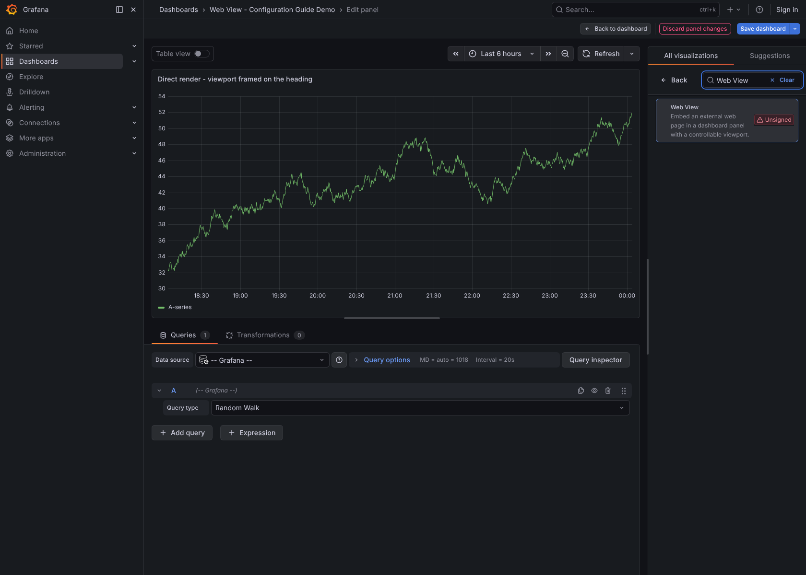
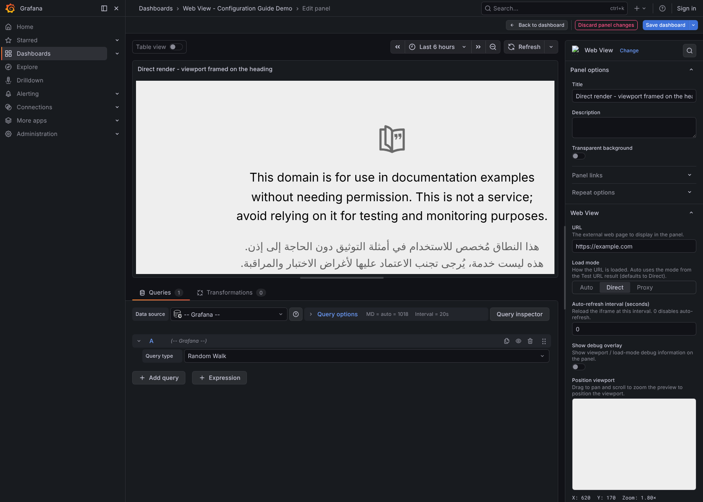
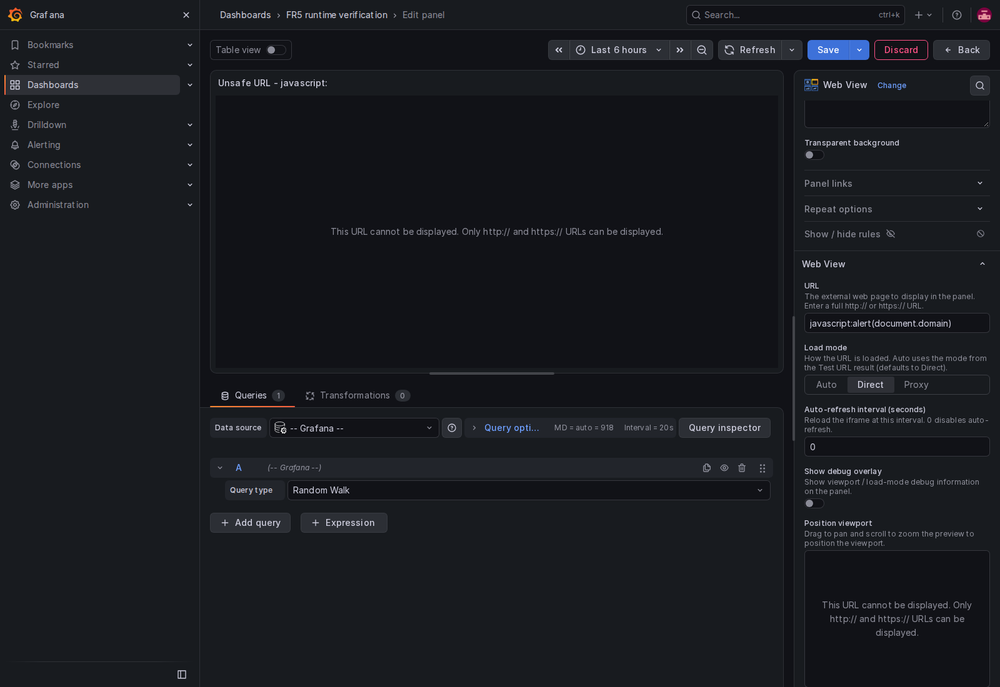
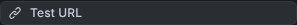
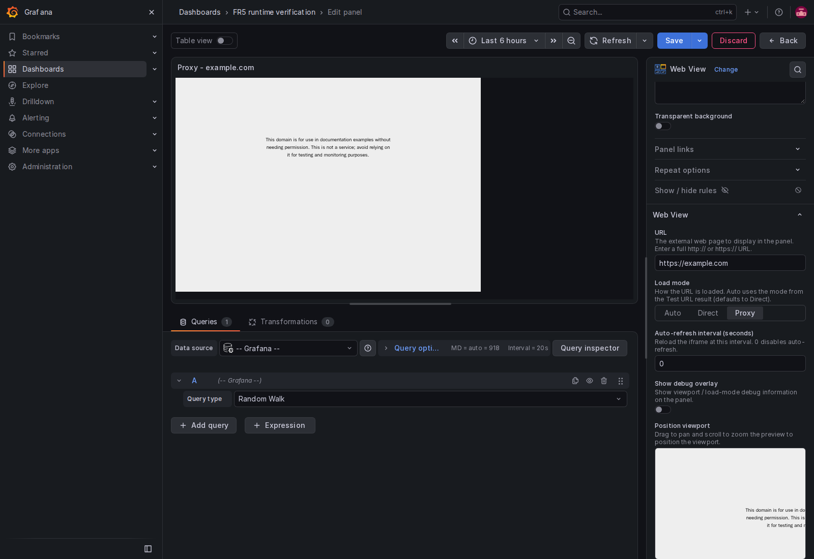
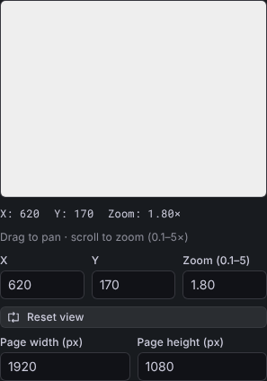
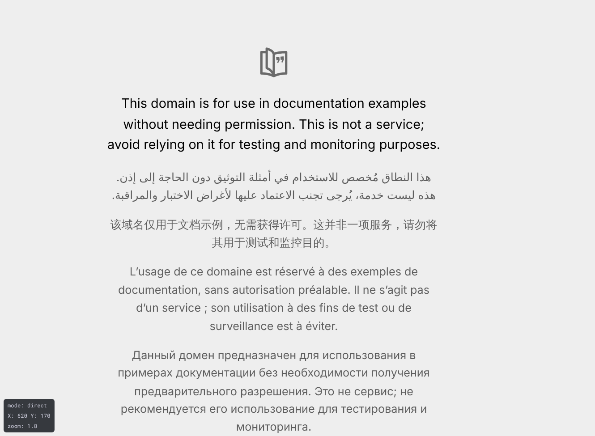
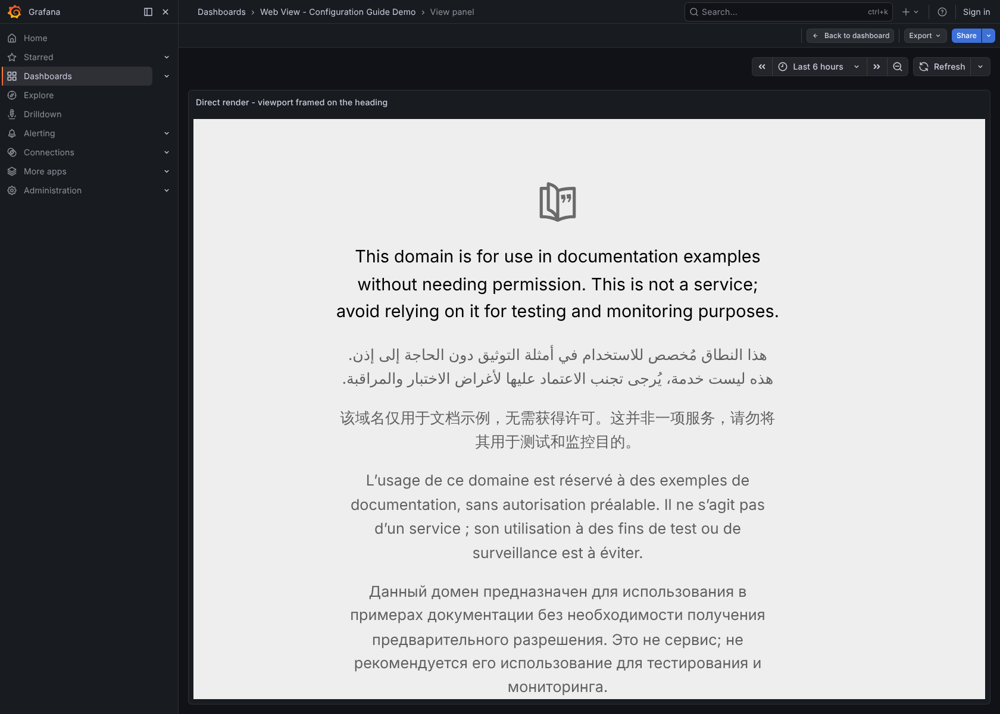
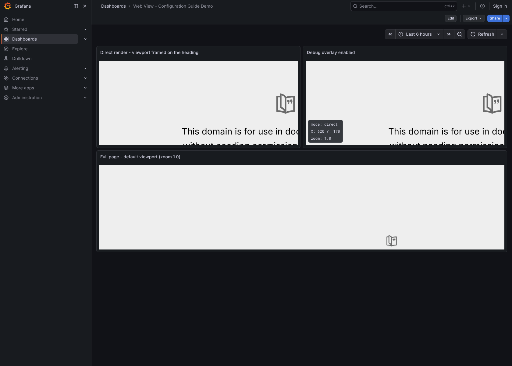
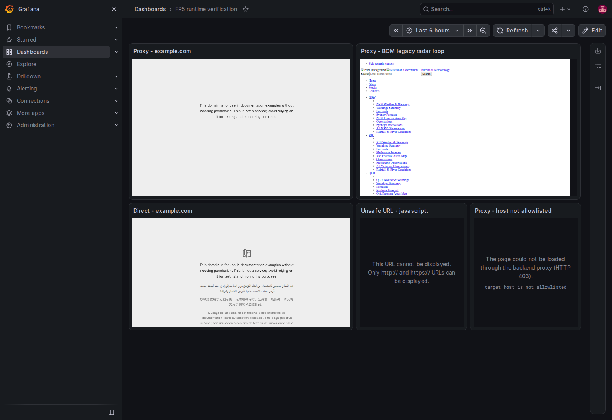

# Configuration Guide

A task-oriented guide for **dashboard authors** using the **Web View** panel
(`wilsonwaters-webview-panel`, shipped by the `wilsonwaters-webview-app` app
plugin). It walks through adding the panel to a dashboard, pointing it at a web
page, framing the region a viewer should see, and tuning its behaviour.

This guide covers the author-facing panel options. For installing and enabling
the plugin, allowlisting domains, and operating the backend proxy, see the
[Administration guide](./administration.md). For the architecture and security
model, see [`architecture.md`](./architecture.md). The project overview is in the
[README](../README.md).

> **Who can do this.** Adding and editing panels requires an **Editor** or
> **Admin** role on the dashboard. The **Test URL** button needs the **Editor** or
> **Admin** organisation role. **Proxy mode and Test URL additionally require an
> administrator to allowlist the target domain first** — see
> [Before you start](#before-you-start).

---

## Contents

1. [Before you start](#before-you-start)
2. [Add a Web View panel](#1-add-a-web-view-panel)
3. [Enter a URL](#2-enter-a-url)
4. [Test the URL (frameability check)](#3-test-the-url-frameability-check)
5. [Choose a load mode](#4-choose-a-load-mode)
6. [Position the viewport](#5-position-the-viewport)
7. [Set the virtual page size](#6-set-the-virtual-page-size)
8. [Auto-refresh](#7-auto-refresh)
9. [Debug overlay](#8-debug-overlay)
10. [Hide elements (proxy mode only)](#9-hide-elements-proxy-mode-only)
11. [Multiple panels on one dashboard](#10-multiple-panels-on-one-dashboard)
12. [Proxy mode: what to expect](#proxy-mode-what-to-expect)
13. [Option reference](#option-reference)

---

## Before you start

The panel can load a page two ways:

- **Direct mode** — a plain browser iframe pointing straight at the target URL.
  Works for any site that *permits* being framed, and renders **inside the
  panel**. Needs no backend and no allowlist.
- **Proxy mode** — the plugin's backend fetches the page, removes the headers
  that block framing (`X-Frame-Options` or a `Content-Security-Policy`
  `frame-ancestors` directive), and the panel shows it in an isolated, sandboxed
  frame. It also renders **inside the panel**.

**Proxy mode is fail-closed.** On a fresh install the backend proxies *nothing*
until an administrator adds the target domain to the allowlist on the app's
**Configuration** page. The [**Test URL**](#3-test-the-url-frameability-check)
check uses the same allowlist, so it fails for any domain that is not on the
list, even a site that allows framing. Ask your Grafana administrator to
allowlist the domain first. See
[Administration → Allowlist management](./administration.md#2-allowlist-management).

> Read [Proxy mode: what to expect](#proxy-mode-what-to-expect) before you rely
> on proxy mode for a production dashboard. Some kinds of page do not work in
> proxy mode.

---

## 1. Add a Web View panel

1. Open a dashboard and choose **Edit → + Add → Visualization**, or edit an
   existing panel.
2. In the visualization picker (top-right of the panel editor), search for
   **Web View** and select it.



The panel editor opens with a live preview on the left and the **Web View**
options on the right, under the standard **Panel options** (Title, Description,
etc.).



> These screenshots come from the local development build, which is
> **unsigned**, so the picker shows an *Unsigned* badge. A signed release build
> does not show it — see [`signing.md`](./signing.md).

---

## 2. Enter a URL

In the **Web View** section, type the full page address (including `https://`)
into the **URL** field.

- Leave it blank and the panel shows *"No URL configured."* until you fill it in.
- The live preview and the viewport positioner update as soon as a URL is
  entered.
- Only absolute `http://` and `https://` URLs are loaded. Any other value — for
  example a relative path, a `javascript:` or `data:` URL, a URL with a user
  name or password (`user:password@host`), or a URL that contains tabs or line
  breaks — shows *"This URL cannot be displayed"* with the reason, and no page
  is loaded. This protects every viewer of the dashboard.



---

## 3. Test the URL (frameability check)

Click **Test URL** to ask the backend whether the page can be framed directly or
needs the proxy.



The result appears as a coloured note beneath the button:

| Result | Meaning | What to do |
| --- | --- | --- |
| **Direct — frames without a proxy** (green) | The site permits framing. | Leave the load mode on **Auto** or set it to **Direct**. |
| **Proxied — framing blocked, use the proxy** (blue) | The site blocks framing; the proxy is needed. | Make sure the domain is [allowlisted](./administration.md#2-allowlist-management), then use **Auto** or **Proxy**. |
| **Error** (red) | The check could not complete (e.g. the domain is not allowlisted, your role is below Editor, or the request was denied). | Read the message. *"target host is not allowlisted"* means the administrator needs to allowlist the domain. *"The URL test requires the Editor or Admin role."* means your organisation role is Viewer. |

The recommendation is saved with the panel (as `detectedMode`) so that
**Auto** mode can apply it at view time *without re-checking*. The check is only
ever run here, in the editor — view mode never re-detects.

If the backend cannot reach the page (for example a timeout or a DNS failure),
the check still returns a result: it recommends **Proxy**, because the proxy
handles more cases than a plain iframe.

> **Test URL requires the plugin backend, an allowlisted domain and the Editor
> or Admin role.** If the backend is unavailable the button is disabled and a
> note explains that only direct iframing is possible. The role check uses your
> basic organisation role; a custom RBAC role that lets a Viewer edit dashboards
> does not unlock **Test URL**. Without the check you can still choose **Direct**
> or **Proxy** by hand.

---

## 4. Choose a load mode

The **Load mode** control decides how the saved URL is loaded:

| Mode | Behaviour |
| --- | --- |
| **Auto** (default) | Use the mode recorded by the last **Test URL** check (`detectedMode`). If no check has been run, it falls back to **Direct**. |
| **Direct** | Always use a plain iframe — no backend. Best for sites that permit framing. Renders inside the panel. |
| **Proxy** | Always route through the backend proxy. Use for sites that block framing. Renders inside the panel in an isolated frame. Requires the domain to be [allowlisted](./administration.md#2-allowlist-management). |

**When to use each**

- Use **Auto** for the simplest flow: run **Test URL** once and let the panel
  pick the right path.
- Use **Direct** when you know the site allows framing (fastest, no backend
  dependency).
- Use **Proxy** for framing-blocked sites, once an admin has allowlisted the
  domain.

In proxy mode the editor preview shows the page through the proxy too, so you
can position the viewport on the same content that viewers will see:



> **If the backend is unavailable**, Auto and Proxy are hidden and only
> **Direct** can be selected; an info note explains why. An already-saved
> `proxy`/`auto` panel is not silently changed — the view-mode guard falls back
> to a clear message rather than a broken frame.

---

## 5. Position the viewport

The **Position viewport** editor lets you frame exactly the region of the page a
viewer should see. This is the panel's headline feature — for example, zooming a
full radar map down to a single city.



Interact with the live preview directly:

- **Drag** the preview to **pan** (move the visible region).
- **Scroll / wheel** over the preview to **zoom**, anchored at the cursor. Zoom
  is clamped to **0.1×–5×**.

Everything you do in the preview is saved automatically — there is no separate
"capture" step. The framed region (horizontal offset **X**, vertical offset
**Y**, and **Zoom**) is written straight into the panel.

For precise control you can also type values into the numeric fields:

- **X** / **Y** — the scroll offset of the saved viewport, in virtual page
  pixels.
- **Zoom** — the scale factor (0.1–5).

The live readout above the inputs always shows the current `X`, `Y` and `Zoom`.
Click **Reset view** to return to the top-left of the page at 1× zoom.

> The viewport you configure here is **static for viewers** — the rendered panel
> is non-interactive, so viewers cannot pan, zoom or click into the embedded
> page. They see precisely the region you framed.

---

## 6. Set the virtual page size

Below the viewport controls, **Page width (px)** and **Page height (px)** set the
dimensions the page is rendered at *before* your zoom/pan transform is applied
(default **1920 × 1080**). Think of it as the virtual browser window the page is
laid out in.

- Increase the width for wide dashboards or pages with responsive layouts that
  only show the desired content at a larger size.
- These are positive pixel values; invalid entries fall back to the defaults.

---

## 7. Auto-refresh

**Auto-refresh interval (seconds)** reloads the embedded page on a timer:

- `0` (default) disables auto-refresh.
- Any positive value reloads the iframe every *N* seconds — useful for status
  pages, radar loops or dashboards that update on their own.
- In proxy mode each reload fetches the page through the proxy again. Every
  open dashboard makes one proxy request per panel per interval, and these
  requests count against the proxy's rate limits. Keep the interval as long as
  the content allows.

Each panel keeps its own independent refresh cycle, so multiple Web View panels
on one dashboard do not interfere with each other.

---

## 8. Debug overlay

Toggle **Show debug overlay** to display a small overlay on the panel with the
resolved **mode**, the viewport **X/Y** offsets and the **zoom** factor. It is
drawn on top of the panel (not inside the page).



Use it while framing a panel, then **turn it off for production dashboards**.

Here is a finished **Direct** panel rendering a page in-panel with a framed
viewport (overlay off):



---

## 9. Hide elements (proxy mode only)

The panel supports a **hide-selectors** option (`hideSelectors`) that removes
page elements — cookie banners, navigation bars, ads — matching a list of CSS
selectors.

Important details:

- **Proxy mode only, server-side.** The selectors are applied by the backend
  while it rewrites the proxied HTML. They have **no effect in direct mode**,
  because the browser's same-origin policy prevents a plain iframe's content from
  being modified.
- **Not a dedicated editor control.** There is currently no field for this in the
  options pane. Set it on the panel's JSON model: **Panel menu → Inspect → Panel
  JSON** (or edit the dashboard JSON) and add it under `options`:

  ```json
  "options": {
    "url": "https://example.com",
    "loadMode": "proxy",
    "hideSelectors": ".cookie-bar\n#top-nav\n.ad-slot"
  }
  ```

- The value is a **newline-separated** list of CSS selectors; blank lines are
  ignored and each selector is trimmed. Each selector is passed to the proxy as a
  `hide=` parameter for server-side removal.

As with any proxy-mode feature, the target domain must be
[allowlisted](./administration.md#2-allowlist-management) by an administrator.

---

## 10. Multiple panels on one dashboard

You can place as many Web View panels on a dashboard as you like, each with its
own URL, load mode, viewport and refresh interval. They are fully independent.



---

## Proxy mode: what to expect

In proxy mode only the HTML page goes through Grafana. The panel shows it in a
frame with an isolated origin, and the viewer's browser loads the page's images,
scripts and stylesheets directly from the original site. This keeps the page
away from the viewer's Grafana session, and it has these effects:

- **The viewer's browser must be able to reach the site.** If only the Grafana
  server can reach it, the page appears without styles or images.
- **Grafana's Content Security Policy blocks proxied scripts.** If your Grafana
  runs with `[security] content_security_policy = true`, proxied pages show
  markup and images only.
- **Cookies and storage are not kept.** The page gets in-memory cookies and
  storage that are lost on every reload, so a page that needs a login or
  remembers settings does not work.
- **Single-page apps that call their own APIs do not work.** Those calls are
  cross-origin from the isolated frame. Web fonts and module scripts load only if
  the site allows cross-origin requests.
- **Bot protection can block the page.** Sites protected by services such as
  Akamai or reCAPTCHA may refuse the proxy or the viewer's browser.
- **Example:** the new Bureau of Meteorology radar page is a single-page app
  with bot protection and does not work in proxy mode. The legacy radar loop
  `https://reg.bom.gov.au/products/IDR663.loop.shtml` works in proxy mode, and
  in direct mode too, because it allows framing.

The panel shows a clear message instead of a broken frame when it cannot load a
page: *"Checking backend availability…"* while it waits, a fallback message if
the backend is unavailable, and *"The page could not be loaded through the
backend proxy (HTTP …)"* with the reason when the proxy refuses the request.



For a site that allows framing, **Direct** mode avoids all of these limits. See
[Troubleshooting](./troubleshooting.md#proxy-mode-page-shows-without-styles-images-or-scripts)
for how to recognise each case.

---

## Option reference

All options live in the panel editor's **Web View** section unless noted.

| Option (editor label) | JSON field | Type / values | Default | Notes |
| --- | --- | --- | --- | --- |
| URL | `url` | string | `""` | The page to embed. Absolute `http://` or `https://` URL only. |
| Load mode | `loadMode` | `auto` \| `direct` \| `proxy` | `auto` | How the URL is loaded. |
| (set by Test URL) | `detectedMode` | `direct` \| `proxy` \| `null` | `null` | Recorded recommendation used by Auto mode. |
| Position viewport → X | `viewportX` | number (px) | `0` | Horizontal offset of the framed region. |
| Position viewport → Y | `viewportY` | number (px) | `0` | Vertical offset of the framed region. |
| Position viewport → Zoom | `viewportZoom` | number `0.1`–`5.0` | `1.0` | Zoom factor (clamped). |
| Page width (px) | `iframeWidth` | number (px) | `1920` | Virtual render width. |
| Page height (px) | `iframeHeight` | number (px) | `1080` | Virtual render height. |
| Auto-refresh interval (seconds) | `refreshIntervalSec` | number (s) | `0` | `0` disables auto-refresh. |
| Show debug overlay | `showDebugOverlay` | boolean | `false` | Overlay of mode / X / Y / zoom. |
| *(JSON model only)* | `hideSelectors` | string (newline-separated) | `""` | Proxy-mode, server-side element hiding. |

---

*Related: [Administration guide](./administration.md) ·
[Architecture & decision log](./architecture.md) ·
[Developer guide](./developer-guide.md) · [README](../README.md)*
